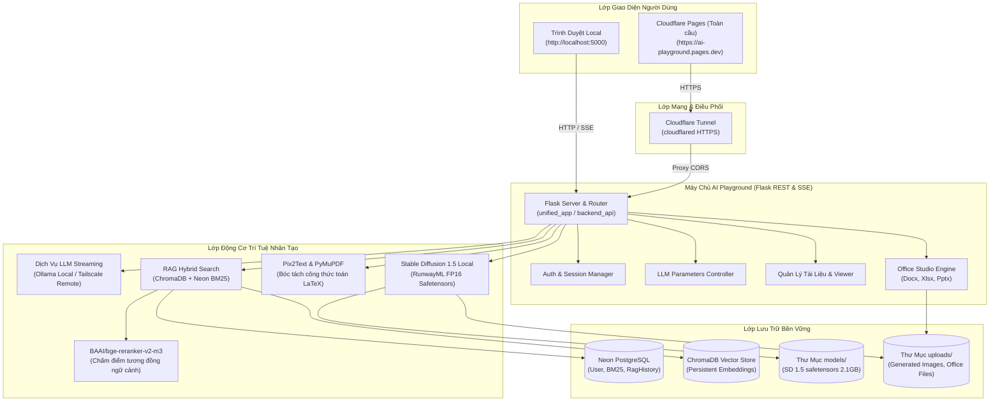

# 🎨 AI Playground — Nền Tảng Trí Tuệ Nhân Tạo & Trợ Lý Tri Thức Đa Năng

<p align="center">
  
  
  
  
  
  
</p>

---

## 📖 Mục Lục
- [🌟 1. Giới Thiệu Tổng Quan](#-1-giới-thiệu-tổng-quan)
- [⚡ 2. Các Tính Năng Nổi Bật](#-2-các-tính-năng-nổi-bật)
  - [💬 2.1. Chat Đa Mô Hình (Multi-LLM) & Phản Hồi Real-time](#-21-chat-đa-mô-hình-multi-llm--phản-hồi-real-time)
  - [⚙️ 2.2. Bộ Tinh Chỉnh Tham Số AI (Parameter Tuning)](#️-22-bộ-tinh-chỉnh-tham-số-ai-parameter-tuning)
  - [🎭 2.3. AI Roleplay & Trợ Lý Nhập Vai Chuyên Sâu](#-23-ai-roleplay--trợ-lý-nhập-vai-chuyên-sâu)
  - [🔍 2.4. RAG Hybrid Search & BGE-Reranker-v2-m3](#-24-rag-hybrid-search--bge-reranker-v2-m3)
  - [📐 2.5. OCR Bóc Tách Đề Thi & Công Thức Toán Học LaTeX](#-25-ocr-bóc-tách-đề-thi--công-thức-toán-học-latex)
  - [📊 2.6. Office Studio (Tạo & Xử Lý Word, Excel, PowerPoint)](#-26-office-studio-tạo--xử-lý-word-excel-powerpoint)
  - [🖼️ 2.7. Tạo Ảnh Nghệ Thuật Offline với Stable Diffusion 1.5](#️-27-tạo-ảnh-nghệ-thuật-offline-với-stable-diffusion-15)
- [🏛️ 3. Sơ Đồ Kiến Trúc Hệ Thống](#️-3-sơ-đồ-kiến-trúc-hệ-thống)
- [📁 4. Cấu Trúc Thư Mục Dự Án](#-4-cấu-trúc-thư-mục-dự-án)
- [💻 5. Yêu Cầu Hệ Thống](#-5-yêu-cầu-hệ-thống)
- [🚀 6. Hướng Dẫn Cài Đặt & Khởi Chạy](#-6-hướng-dẫn-cài-đặt--khởi-chạy)
  - [Cách 1: Khởi Động 1-Click trên Windows (Khuyên dùng)](#cách-1-khởi-động-1-click-trên-windows-khuyên-dùng)
  - [Cách 2: Chạy Thủ Công từ Python / Conda](#cách-2-chạy-thủ-công-từ-python--conda)
  - [Cách 3: Triển Khai Bằng Docker & Docker Compose](#cách-3-triển-khai-bằng-docker--docker-compose)
  - [Cách 4: Triển Khai Frontend lên Cloudflare Pages & Backend API qua Tunnel](#cách-4-triển-khai-frontend-lên-cloudflare-pages--backend-api-qua-tunnel)
- [⚙️ 7. Cấu Hình & Biến Môi Trường](#️-7-cấu-hình--biến-môi-trường)
- [📡 8. Danh Sách RESTful & Streaming API](#-8-danh-sách-restful--streaming-api)
- [❓ 9. Xử Lý Sự Cố Thường Gặp (FAQs)](#-9-xử-lý-sự-cố-thường-gặp-faqs)
- [📄 10. Giấy Phép & Đóng Góp](#-10-giấy-phép--đóng-góp)

---

## 🌟 1. Giới Thiệu Tổng Quan

**AI Playground** (tiền thân là *HPU2 AI Assistant*) là một nền tảng trí tuệ nhân tạo toàn diện và hợp nhất, được thiết kế để phục vụ nghiên cứu, học tập, sáng tạo nội dung và tự động hóa tác vụ văn phòng. 

Hệ thống kết hợp sức mạnh của:
1. **Hàng loạt mô hình ngôn ngữ lớn (LLMs)** chạy cục bộ qua Ollama hoặc đám mây.
2. **Kỹ thuật tìm kiếm tăng cường thông tin (RAG Hybrid Search)** kết hợp Vector ChromaDB + Khớp từ khóa BM25 + Xếp hạng lại thông minh BGE Reranker.
3. **Thị giác máy tính & OCR bóc tách công thức toán học LaTeX** từ đề thi và tài liệu học thuật.
4. **Trợ lý văn phòng thông minh (Office Studio)** tạo file Word, bảng tính Excel có công thức biểu đồ, và slide trình chiếu PowerPoint tự động.
5. **Mô hình tạo ảnh nghệ thuật cục bộ (Stable Diffusion 1.5)** chạy hoàn toàn Offline trên card đồ họa phổ thông (VRAM từ 4GB).

---

## ⚡ 2. Các Tính Năng Nổi Bật

### 💬 2.1. Chat Đa Mô Hình (Multi-LLM) & Phản Hồi Real-time
* **Hỗ trợ đa dạng Model**: Qwen 2.5 (14B / 32B), DeepSeek R1 8B (suy luận logic theo chuỗi tư duy CoT), Llama 3.1 / 3.2, GLM-4.7 Flash, Granite 3.2 Vision (nhận diện hình ảnh đa phương thức), Mistral...
* **SSE Real-time Streaming**: Cơ chế máy gõ chữ mượt mà, phản hồi ngay lập tức không có độ trễ.
* **Định dạng trực quan**: Render công thức toán KaTeX (`$E=mc^2$`, `$$\int f(x)dx$$`), Markdown, bảng biểu và khối code có nút copy nhanh.

### ⚙️ 2.2. Bộ Tinh Chỉnh Tham Số AI (Parameter Tuning)
* **Bảng điều khiển trực quan**: Dễ dàng tùy biến hành vi của LLM ngay trong giao diện:
  * **Temperature** (0.0 – 1.5): Điều chỉnh độ sáng tạo hoặc tính nhất quán logic.
  * **Top P** (0.0 – 1.0): Giới hạn không gian xác suất lấy mẫu từ ngữ (Nucleus Sampling).
  * **Top K** (1 – 100): Giới hạn số lượng token tiềm năng ứng cử viên.
  * **Max Output Tokens** (128 – 8192): Độ dài phản hồi tối đa của câu trả lời.
  * **Context Length** (1024 – 32768): Số lượng ngữ cảnh bộ nhớ cấp phát cho mô hình.
  * **System Prompt**: Hướng dẫn chỉ thị cá tính và nhiệm vụ cho AI.
* **4 Cấu Hình Sẵn (Presets 1-Click)**:
  * 🎨 *Sáng tạo* (Creative): Thích hợp viết truyện, thơ ca, tạo kịch bản.
  * ⚖️ *Cân bằng* (Balanced): Mặc định lý tưởng cho hội thoại hàng ngày.
  * 🎯 *Chính xác* (Precise): Suy luận dữ liệu, nghiên cứu học thuật, đối chiếu tài liệu.
  * 💻 *Lập trình* (Coding): Viết code tối ưu, kiểm thử và tìm lỗi logic.

### 🎭 2.3. AI Roleplay & Trợ Lý Nhập Vai Chuyên Sâu
* Hỗ trợ xây dựng các trợ lý chuyên môn hoặc nhân vật nhập vai với tính cách, giọng văn và Avatar riêng biệt.
* Tích hợp sẵn các Persona tiêu biểu:
  * 🪄 *Frieren*: Pháp sư ngàn năm điềm tĩnh, uyên bác và giàu trải nghiệm.
  * 🏹 *Aki Sorrel*: Xạ thủ tự do, phóng khoáng, dí dỏm.
  * 👨‍🏫 *Trợ Giảng AI*: Cố vấn học tập, giải đề thi, giải thích chi tiết từng bước.
  * 🤖 *EduBot*: Hướng dẫn quy chế, thủ tục và thông tin đào tạo.
* Cho phép tạo, sửa, xóa, gắn avatar cá nhân và tùy chỉnh `system_prompt` theo nhu cầu.

### 🔍 2.4. RAG Hybrid Search & BGE-Reranker-v2-m3
* **Cơ chế Hybrid Fusion**:
  1. *Vector Search*: Tìm kiếm ngữ nghĩa trên ChromaDB (nội bộ hoặc đám mây).
  2. *BM25 Keyword Search*: Tìm kiếm từ khóa chính xác trên cơ sở dữ liệu văn bản Neon PostgreSQL.
* **BGE-Reranker-v2-m3**:
  * Tự động chấm điểm độ liên quan ngữ cảnh (Relevance Score từ 0% đến 100%).
  * Loại bỏ các đoạn nhiễu, chỉ chọn Top 3–5 đoạn trích đắt giá nhất nạp vào LLM.
* **Source Badges (Trích Dẫn Nguồn)**: Dưới mỗi câu trả lời có nút hiển thị tài liệu trích dẫn kèm phần trăm độ tin cậy. Nhấp vào để đọc ngay đoạn văn bản gốc tương ứng.

### 📐 2.5. OCR Bóc Tách Đề Thi & Công Thức Toán Học LaTeX
* Hỗ trợ tải lên file **PDF nhiều trang** hoặc **Hình ảnh (PNG/JPG)**.
* Sử dụng **PyMuPDF** để giải mã trang tài liệu tốc độ cao.
* Kết hợp mô hình nhận diện cấu trúc bố cục tài liệu và **Pix2Text** bóc tách công thức toán học phức tạp thành mã LaTeX chuẩn (`$$...$$`).
* Hiển thị trực quan song song: Ảnh cắt vùng gốc + Mã LaTeX + Bản render KaTeX.
* **⚡ Nút 1-Click "Nạp vào Chatbot"**: Tự động chia nhỏ nội dung (chunking) và lưu vào ChromaDB để hỏi đáp ngay lập tức.

### 📊 2.6. Office Studio (Tạo & Xử Lý Word, Excel, PowerPoint)
* **Word (`.docx`)**: Tự động soạn thảo văn bản quy chuẩn, giáo án, báo cáo có mục lục, bảng và tiêu đề chuyên nghiệp.
* **Excel (`.xlsx`)**: Tự động tổng hợp số liệu, áp dụng công thức tính toán (`SUM`, `AVERAGE`, `VLOOKUP`) và vẽ biểu đồ trực quan (cột, tròn, đường).
* **PowerPoint (`.pptx`)**: Tự động tạo bài thuyết trình hoàn chỉnh với bố cục slide mạch lạc, thẩm mỹ.
* Nút tải file trực tiếp về máy tính chỉ với 1 cú click.

### 🖼️ 2.7. Tạo Ảnh Nghệ Thuật Offline với Stable Diffusion 1.5
* Chạy **100% Offline** trên máy cục bộ, không gửi dữ liệu ra bên ngoài.
* **Tối ưu hóa đặc biệt cho GPU dung lượng VRAM khiêm tốn (từ 4GB như NVIDIA Quadro P600)**:
  * Sử dụng định dạng `safetensors FP16` (chỉ chiếm ~2.0 GB VRAM).
  * Kỹ thuật `sequential_cpu_offload` và `attention_slicing` triệt tiêu lỗi quá bộ nhớ (CUDA Out of Memory).
* **Quản lý bộ nhớ thông minh (VRAM Manager)**:
  * Cho phép bật/tắt (Load / Unload) mô hình theo yêu cầu để giải phóng 100% bộ nhớ cho các tác vụ khác.
  * Hiển thị trạng thái tải, thanh đo tiến trình và dung lượng VRAM thực tế theo thời gian thực.

---

## 🏛️ 3. Sơ Đồ Kiến Trúc Hệ Thống



---

## 📁 4. Cấu Trúc Thư Mục Dự Án

```
Chatbot/
├── unified_app/                    # [CHÍNH] Ứng dụng tích hợp tất cả trong một (Web UI + Backend API)
│   ├── app.py                      # Flask Server trung tâm phục vụ cả Web UI và API Streaming
│   ├── core/                       # Lớp lõi xử lý nghiệp vụ AI
│   │   ├── config.py               # Quản lý cấu hình, đường dẫn, biến môi trường
│   │   ├── auth_service.py         # Xác thực người dùng và phân quyền (Admin / User)
│   │   ├── llm_service.py          # Quản lý giao tiếp LLM & Streaming qua Ollama
│   │   ├── rag_service.py          # Hybrid Search (Chroma + BM25) & BGE Reranker v2-m3
│   │   ├── ocr_service.py          # Trích xuất PDF/Ảnh & Pix2Text công thức LaTeX
│   │   ├── sd_service.py           # Quản lý nạp/hạ Stable Diffusion 1.5 & sinh ảnh GPU
│   │   ├── roleplay_service.py     # Quản lý nhân vật AI Personas & chat nhập vai
│   │   ├── document_service.py     # Quản lý thư viện tài liệu đã tải lên
│   │   ├── chat_history_service.py # Quản lý phiên hội thoại lưu trữ
│   │   └── office/                 # Module tạo & xử lý tài liệu Word, Excel, PowerPoint
│   ├── static/                     # Tài nguyên tĩnh giao diện Web
│   │   ├── css/style.css           # Giao diện hiện đại (Dark/Light mode, Glassmorphism)
│   │   └── js/app.js               # Logic điều khiển giao diện, SSE, KaTeX, RAG & SD
│   ├── templates/                  # Template HTML giao diện
│   │   └── index.html              # Dashboard duy nhất tích hợp toàn bộ phân hệ
│   └── data/                       # Dữ liệu nội bộ (Session, Documents index)
│
├── backend_api/                    # Backend API độc lập (Dành cho việc deploy tách biệt với Cloudflare)
│   ├── app.py                      # Máy chủ API REST & SSE (CORS mở rộng)
│   └── core/                       # Tương thích 100% logic nghiệp vụ với unified_app
│
├── frontend_cloudflare/            # Mã nguồn tĩnh giao diện sẵn sàng triển khai lên Cloudflare Pages
│   ├── index.html                  # Giao diện SPA tĩnh
│   ├── _headers                    # File cấu hình CORS & Cache chuẩn của Cloudflare
│   ├── css/style.css               # Bộ phong cách giao diện đầy đủ
│   └── js/                         # JavaScript client hỗ trợ cấu hình động Backend URL
│
├── models/                         # Thư mục lưu trữ trọng số mô hình AI
│   └── sd_v15_fp16/                # Trọng số Stable Diffusion 1.5 FP16 (~2.1 GB safetensors)
│       ├── unet/                   # Khối UNet diffusion_pytorch_model.fp16.safetensors
│       ├── text_encoder/           # Text encoder model.fp16.safetensors
│       ├── vae/                    # VAE diffusion_pytorch_model.fp16.safetensors
│       └── tokenizer/              # Bộ từ điển và tokenizer
│
├── data/                           # Thư mục lưu trữ dữ liệu bền vững (ChromaDB cache, sessions)
├── uploads/                        # Thư mục lưu trữ file người dùng tải lên và ảnh do AI sinh ra
│   └── generated_images/           # Ảnh xuất ra từ Stable Diffusion 1.5
├── tools/                          # Bộ công cụ kiểm thử và hỗ trợ tải mô hình
│   ├── download_sd_fp16.py         # Script tải trọn gói trọng số SD 1.5 an toàn
│   └── test_sd_gpu.py              # Script kiểm thử tốc độ sinh ảnh và nạp VRAM GPU
│
├── Dockerfile                      # File xây dựng Docker Image hỗ trợ CUDA & CPU fallback
├── docker-compose.yml              # File triển khai đa container 1 lệnh với Volume Mount
├── .dockerignore                   # Quy tắc loại trừ file rác khi build Docker Image
├── requirements.txt                # Danh sách đầy đủ các thư viện Python được tối ưu phiên bản
├── start_unified_app.bat           # Phím tắt 1-click khởi chạy Unified App trên Windows
├── start_backend.bat               # Phím tắt 1-click khởi chạy Backend API độc lập
├── deploy_cloudflare_guide.md      # Cẩm nang chi tiết triển khai lên Cloudflare Pages & Tunnel
└── README.md                       # Tài liệu hướng dẫn toàn diện này
```

---

## 💻 5. Yêu Cầu Hệ Thống

| Thành Phần | Cấu Hình Tối Thiểu (CPU Mode) | Cấu Hình Khuyên Dùng (GPU Mode) |
| :--- | :--- | :--- |
| **Hệ Điều Hành** | Windows 10/11, Ubuntu 20.04+, macOS | Windows 10/11 64-bit hoặc Linux Ubuntu |
| **Bộ Nhớ RAM** | 8 GB RAM | 16 GB RAM trở lên |
| **Card Đồ Họa (GPU)** | Không bắt buộc (Chạy qua CPU) | NVIDIA GPU với tối thiểu **4 GB VRAM** (Quadro P600, GTX 1050Ti, GTX 1650, RTX 2060/3060...) |
| **Dung Lượng Đĩa** | 10 GB dung lượng trống | 20 GB dung lượng SSD trống |
| **Phần Mềm** | Python 3.10 hoặc 3.11, Ollama | Python 3.10/3.11, CUDA Toolkit 12.x, Docker Desktop (tùy chọn) |

---

## 🚀 6. Hướng Dẫn Cài Đặt & Khởi Chạy

### Cách 1: Khởi Động 1-Click trên Windows (Khuyên dùng)

Nếu bạn đang sử dụng môi trường Windows và đã có Python / Conda cài sẵn:

1. **Khởi chạy ứng dụng Hợp Nhất (Web UI + Backend API cùng chạy trên cổng 5000):**
   * Nhấp đúp chuột vào file:
     👉 [`start_unified_app.bat`](file:///c:/Users/admin/Desktop/Chatbot/start_unified_app.bat)
   * Ứng dụng sẽ tự động kích hoạt môi trường, khởi động server và mở trình duyệt tại:
     👉 **`http://localhost:5000`**

2. **Hoặc khởi chạy riêng Backend API (nếu dùng với Cloudflare Pages):**
   * Nhấp đúp chuột vào file:
     👉 [`start_backend.bat`](file:///c:/Users/admin/Desktop/Chatbot/start_backend.bat)
   * Backend API lắng nghe tại: `http://localhost:5000`.

---

### Cách 2: Chạy Thủ Công từ Python / Conda

1. **Clone hoặc tải mã nguồn dự án về máy:**
   ```bash
   cd c:\Users\admin\Desktop\Chatbot
   ```

2. **Cài đặt các thư viện cần thiết:**
   ```bash
   pip install -r requirements.txt
   ```
   *(Nếu dùng GPU NVIDIA, khuyến nghị cài đặt PyTorch hỗ trợ CUDA bằng lệnh: `pip install torch torchvision --index-url https://download.pytorch.org/whl/cu124`)*

3. **Khởi chạy ứng dụng:**
   ```bash
   cd unified_app
   python app.py
   ```
4. Truy cập trình duyệt tại: **`http://localhost:5000`**.

---

### Cách 3: Triển Khai Bằng Docker & Docker Compose

Docker giúp đóng gói toàn bộ môi trường, thư viện C++, PyTorch, CUDA mà không cần cài đặt phức tạp trên máy chủ.

1. **Đảm bảo máy đã cài đặt Docker & Docker Desktop:**
   * Trên Windows/Linux, đảm bảo bạn đã cài đặt [Docker Desktop](https://www.docker.com/products/docker-desktop/) và [NVIDIA Container Toolkit](https://docs.nvidia.com/datacenter/cloud-native/container-toolkit/latest/install-guide.html) (nếu muốn sử dụng GPU trong container).

2. **Khởi chạy dịch vụ bằng Docker Compose:**
   Tại thư mục gốc dự án, mở Terminal / PowerShell và chạy:
   ```bash
   docker compose up -d --build
   ```

3. **Kiểm tra trạng thái container:**
   ```bash
   docker compose ps
   docker compose logs -f ai-playground
   ```

4. **Truy cập ứng dụng:**
   * Mở trình duyệt tại: **`http://localhost:5000`**
   * *Lưu ý về Volume Mount*: Toàn bộ mô hình đã tải (`models/`), dữ liệu hội thoại (`data/`) và file người dùng tải lên (`uploads/`) được gắn kết trực tiếp với máy tính chủ (Host), không bị mất đi khi tắt hoặc cập nhật container.

5. **Dừng hệ thống:**
   ```bash
   docker compose down
   ```

---

### Cách 4: Triển Khai Frontend lên Cloudflare Pages & Backend API qua Tunnel

Mô hình triển khai này mang lại tốc độ truy cập toàn cầu, bảo mật cao và miễn phí 100%:

```
[Người Dùng Toàn Cầu] ──> [Cloudflare Pages CDN] ──> [Cloudflare Tunnel] ──> [Máy Chủ Cục Bộ Có GPU]
```

1. **Triển khai Frontend lên Cloudflare Pages**:
   * Đăng nhập vào [Cloudflare Dashboard](https://dash.cloudflare.com/) -> **Workers & Pages** -> **Create application** -> **Pages** -> **Upload assets**.
   * Tải toàn bộ thư mục `frontend_cloudflare/` (hoặc kéo thả file `frontend_cloudflare.zip`).
   * Bấm **Deploy**. Bạn sẽ nhận được URL toàn cầu (ví dụ: `https://ai-playground.pages.dev`).

2. **Công khai Backend API bằng Cloudflare Tunnel (Không cần mở cổng mạng / Port Forward)**:
   * Chạy Backend: nhấp đúp [`start_backend.bat`](file:///c:/Users/admin/Desktop/Chatbot/start_backend.bat).
   * Tạo đường hầm HTTPS miễn phí trong 5 giây:
     ```bash
     cloudflared tunnel --url http://localhost:5000
     ```
   * Cloudflare sẽ cấp 1 URL HTTPS (ví dụ: `https://your-tunnel-name.trycloudflare.com`).

3. **Kết nối Frontend với Backend**:
   * Truy cập vào trang web Cloudflare Pages của bạn.
   * Nhấp vào biểu tượng bánh răng **⚙️ (Cài đặt API)** ở góc phải màn hình, dán đường dẫn URL Tunnel vào và bấm **Lưu & Kết Nối**.
   * Đèn tín hiệu sẽ chuyển sang **🟢 API Online**!
   * *Xem tài liệu chi tiết tại:* [`deploy_cloudflare_guide.md`](file:///c:/Users/admin/Desktop/Chatbot/deploy_cloudflare_guide.md).

---

## ⚙️ 7. Cấu Hình & Biến Môi Trường

Bạn có thể chỉnh sửa tệp [`unified_app/core/config.py`](file:///c:/Users/admin/Desktop/Chatbot/unified_app/core/config.py) hoặc thiết lập các biến môi trường tương ứng:

| Biến Môi Trường | Mặc Định | Mô Tả |
| :--- | :--- | :--- |
| `PORT` | `5000` | Cổng dịch vụ Web & API |
| `OLLAMA_LOCAL_URL` | `http://localhost:11434` | Địa chỉ máy chủ Ollama chạy trên máy cục bộ |
| `OLLAMA_REMOTE_URL` | `http://chatbot.tail36da8e.ts.net:11434` | Địa chỉ máy chủ Ollama từ xa qua mạng Tailscale |
| `DB_HOST` | `ep-solitary-surf-a1x7p6aa...neon.tech` | Địa chỉ máy chủ PostgreSQL Neon |
| `RERANKER_MODEL` | `BAAI/bge-reranker-v2-m3` | Tên mô hình HuggingFace dùng để xếp hạng lại tài liệu RAG |
| `RERANKER_THRESHOLD` | `0.30` | Ngưỡng điểm tin cậy tối thiểu để chọn tài liệu vào ngữ cảnh LLM |
| `RERANKER_TOP_K` | `5` | Số lượng tài liệu trích dẫn tối đa đưa vào câu trả lời |

---

## 📡 8. Danh Sách RESTful & Streaming API

| Phương Thức | Endpoint | Chức Năng | Định Dạng Dữ Liệu |
| :--- | :--- | :--- | :--- |
| `POST` | `/api/chat/stream` | Hỏi đáp hội thoại LLM & RAG | Server-Sent Events (SSE Stream) |
| `GET` | `/api/models` | Lấy danh sách mô hình LLM sẵn có | JSON |
| `POST` | `/api/image/generate` | Sinh ảnh nghệ thuật (Stable Diffusion) | JSON (Prompt, steps, cfg, seed) |
| `GET` | `/api/image/status` | Kiểm tra tình trạng nạp mô hình & VRAM GPU | JSON |
| `POST` | `/api/image/load_model` | Nạp mô hình SD 1.5 vào VRAM GPU | JSON |
| `POST` | `/api/image/unload_model`| Giải phóng mô hình SD 1.5 khỏi VRAM | JSON |
| `POST` | `/api/ocr/upload` | Tải lên PDF/Ảnh và bóc tách công thức toán | Multipart Form Data |
| `POST` | `/api/ocr/ingest` | Nạp dữ liệu vừa OCR vào ChromaDB | JSON |
| `GET` | `/api/documents` | Lấy danh sách tài liệu trong hệ thống | JSON |
| `POST` | `/api/documents/upload` | Tải tài liệu người dùng lên hệ thống | Multipart Form Data |
| `POST` | `/api/office/generate` | Tạo file Word, Excel, PowerPoint tự động | JSON |
| `GET` | `/api/roleplay/characters` | Lấy danh sách các nhân vật Persona AI | JSON |
| `POST` | `/api/auth/login` | Đăng nhập tài khoản hệ thống | JSON |

---

## ❓ 9. Xử Lý Sự Cố Thường Gặp (FAQs)

### 1. Mô hình Stable Diffusion 1.5 có tự động tải về không?
> Có. Hệ thống đã tích hợp sẵn trọng số FP16 Safetensors tối ưu tại thư mục `models/sd_v15_fp16/`. Nếu chưa có, bạn chỉ cần bấm **"Tải mô hình"** trên giao diện Web hoặc chạy script:
> ```bash
> python tools/download_sd_fp16.py
> ```
> Quá trình tải có thanh đo tiến trình thực tế và lưu trữ an toàn.

### 2. GPU của tôi chỉ có 4GB VRAM, có bị lỗi CUDA Out of Memory không?
> Không. Kiến trúc `SDService` của AI Playground đã được tối ưu chuyên biệt cho GPU 4GB (đã kiểm nghiệm thực tế trên NVIDIA Quadro P600 4GB). Nhờ kỹ thuật `enable_sequential_cpu_offload` và `enable_attention_slicing`, mô hình chỉ chiếm khoảng **2.0 GB VRAM**, tạo ảnh 512x512 hoàn toàn trơn tru.

### 3. Làm sao để gọi máy chủ Ollama trên máy host từ bên trong Docker Container?
> Trong file `docker-compose.yml`, biến môi trường `OLLAMA_LOCAL_URL` đã được cấu hình sẵn là `http://host.docker.internal:11434` cùng với cờ `extra_hosts: ["host.docker.internal:host-gateway"]`, cho phép container giao tiếp trực tiếp với Ollama trên máy tính chủ mà không cần cấu hình thêm.

### 4. Giao diện trên Cloudflare Pages không kết nối được Backend?
> Hãy kiểm tra:
> 1. Backend API đã được bật chưa (`start_backend.bat`).
> 2. Đã chạy lệnh `cloudflared tunnel --url http://localhost:5000` để lấy URL HTTPS chưa.
> 3. Đã dán URL HTTPS vào mục **⚙️ Cài đặt API** trên góc trên bên phải trang web chưa.

---

## 📄 10. Giấy Phép & Đóng Góp

* Dự án được phát triển nhằm mục đích giáo dục, nghiên cứu và phát triển trợ lý ảo AI đa năng.
* Sử dụng các mô hình mã nguồn mở tiêu biểu:
  * **RunwayML Stable Diffusion 1.5** (CreativeML OpenRAIL-M)
  * **BAAI/bge-reranker-v2-m3** (MIT License)
  * **Ollama & Open-Weight LLMs** (Qwen, Llama 3, DeepSeek)
  * **Pix2Text & PyMuPDF**

---

<p align="center">
  <b>✨ AI Playground — Nơi Kết Nối Trí Tuệ & Sáng Tạo Đột Phá ✨</b>
</p>
